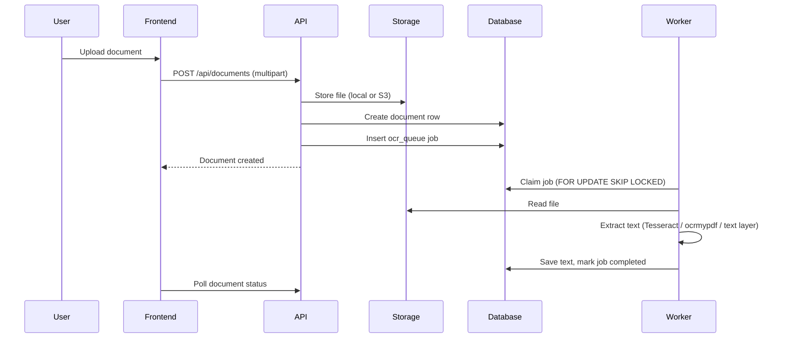
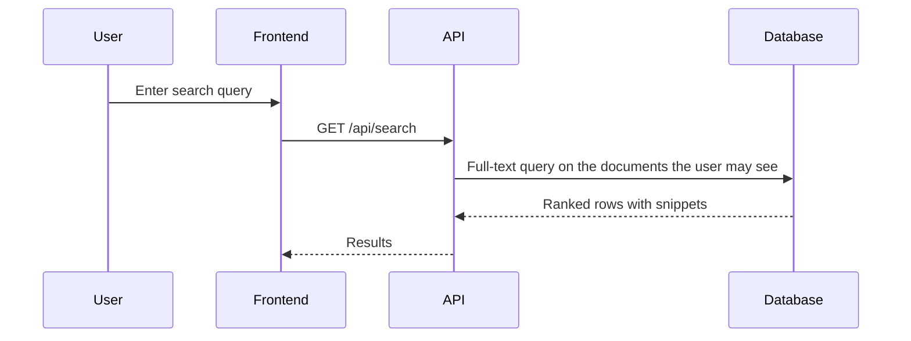

# Architecture Overview

An overview of how Readur is built: the processes, the code layout, and how a document moves through the system.

## Table of Contents

- [System Architecture](#system-architecture)
- [Technology Stack](#technology-stack)
- [Component Overview](#component-overview)
  - [Backend (Rust/Axum)](#backend-rustaxum)
  - [Frontend (React)](#frontend-react)
  - [Database (PostgreSQL)](#database-postgresql)
  - [OCR Engine](#ocr-engine)
- [Data Flow](#data-flow)
- [Security Architecture](#security-architecture)
- [Scalability](#scalability)
- [Monitoring and Observability](#monitoring-and-observability)

## System Architecture

Readur is a single server process plus PostgreSQL:

```text
 Browser / API client / MCP client
              │  HTTP (port 8000)
              ▼
 ┌──────────────────────────────────────────────┐
 │ readur (one Rust binary)                     │
 │  - REST API under /api, MCP at /api/mcp      │
 │  - serves the built React frontend           │
 │  - OCR queue worker                          │
 │  - watch folder, source sync scheduler       │
 └──────────┬───────────────────┬───────────────┘
            │                   │
            ▼                   ▼
      PostgreSQL         File storage: UPLOAD_PATH
                         or an S3 bucket
```

The same process serves the API and the static frontend (from `frontend/dist`), runs the OCR worker, watches the watch folder, and syncs WebDAV, S3 and local-folder sources on a schedule. There is no separate worker process, cache or message broker.

## Technology Stack

### Backend

- Rust, with Tokio as the async runtime and Axum as the web framework
- SQLx for PostgreSQL access; migrations in `migrations/` run automatically at startup
- Authentication: JWT login tokens, API keys, optional OIDC; passwords hashed with bcrypt
- OCR: Tesseract via the `tesseract` crate (the `ocr` Cargo feature), plus the `ocrmypdf`, `pdftotext`, `pdftoppm`, `antiword` and `catdoc` command-line tools
- Object storage: the AWS SDK for S3 (the `s3` Cargo feature)
- API description: utoipa (OpenAPI) and ts-rs (generated TypeScript types in `frontend/src/types/generated/`)
- MCP server: rmcp

### Frontend

- React 19 with TypeScript, built with Vite
- React Aria Components for UI primitives, with CSS modules
- React Router, Axios, i18next
- Vitest for unit and integration tests, Playwright for E2E tests

### Infrastructure

- PostgreSQL (the Compose file and the tests use PostgreSQL 18)
- Docker image built in three stages (frontend, backend, `debian:bookworm-slim` runtime), published as `ghcr.io/readur/readur`
- Helm chart in `charts/readur`

## Component Overview

### Backend (Rust/Axum)

```text
src/
├── main.rs            # startup: config, database, storage, OCR worker, schedulers, HTTP server
├── lib.rs             # AppState and module list
├── config.rs, config/ # environment-variable configuration
├── commands/          # CLI subcommands (reset-admin-password, rotate-jwt-secret)
├── auth.rs, oidc.rs   # AuthUser/AdminUser extractors, API keys, OIDC
├── routes/            # HTTP handlers, mounted in routes/mod.rs
├── services/          # business logic: documents, search, sources, file storage, S3, WebDAV
├── db/                # SQL queries, grouped by table
├── models/            # request/response and database types
├── errors/            # typed API errors (see ERROR_SYSTEM.md)
├── ocr/               # OCR engine, OCR queue and worker
├── ingestion/         # creating documents (deduplication, batch import)
├── scheduling/        # watch folder, per-user watch directories, source sync scheduler
├── storage/           # StorageBackend trait: local filesystem or S3
├── mcp/               # Model Context Protocol server and tools
├── monitoring/        # error manager, request throttler, database monitoring
└── bin/               # developer and admin tools (migrate_to_s3, batch_ingest, ...)
```

`routes/mod.rs` lists every router and its mount point (`/api/auth/`, `/api/documents`, `/api/search`, `/api/sources`, `/api/mcp`, `/metrics`, ...); the full list of endpoints is in the [API Reference](../api-reference.md). Handlers take the shared `AppState` (database, configuration, file service, queue service, schedulers) and an `AuthUser` or `AdminUser` extractor for authentication.

### Frontend (React)

```text
frontend/src/
├── app/         # routes and redirects for old URLs
├── features/    # screens by area: auth, board, document, intake, labels, library, settings, shell, sources
├── ui/          # shared UI components (Button, Dialog, SlideOver, DocumentCard, ...)
├── services/    # API client
├── contexts/    # React contexts
├── i18n/        # translations
├── theme/, styles/
├── types/       # including generated/ from ts-rs
└── test/        # Vitest setup
```

### Database (PostgreSQL)

Main tables (from `migrations/`):

| Area | Tables |
|------|--------|
| Users and auth | `users`, `api_keys`, `auth_ephemeral`, `server_secrets`, `settings` (per-user settings) |
| Documents | `documents`, `failed_documents`, `ignored_files`, `processed_images`, `document_comments`, `shared_links` |
| Labels | `labels`, `document_labels`, `source_labels` |
| OCR | `ocr_queue`, `ocr_retry_history`, `ocr_metrics` |
| Sources and sync | `sources`, `source_scan_failures`, `webdav_files`, `webdav_directories`, `webdav_sync_state`, `webdav_sync_sessions`, `webdav_directory_metrics`, `webdav_request_metrics` |
| Other | `notifications` |

Full-text search uses PostgreSQL's built-in text search over the document content and OCR text (a GIN index on `to_tsvector`). Database guardrails (constraints and triggers) are described in [Database Guardrails](DATABASE_GUARDRAILS.md).

### OCR Engine

1. A document is created by an upload, the watch folder, a source sync or a batch import, and an OCR job is added to `ocr_queue` with a priority (see [OCR Queue](QUEUE_IMPROVEMENTS.md)).
2. The worker claims jobs, up to `CONCURRENT_OCR_JOBS` at a time.
3. Text is extracted by file type: images go through Tesseract after preprocessing; PDFs use their text layer or are OCRed with ocrmypdf; Office files are read directly (DOCX/XLSX XML, `antiword`/`catdoc` for old `.doc`); plain text is read as is.
4. The text, confidence and word count are stored on the document, which makes it searchable.

## Data Flow

### Document Upload Flow



### Search Flow



Source sync progress is pushed to the browser over a WebSocket (`/api/sources/{id}/sync/progress/ws`).

## Security Architecture

- **Authentication**: login returns a JWT signed with `JWT_SECRET` (generated and stored in the database when not set), valid for `JWT_TTL_HOURS`. API keys are sent the same way, as `Authorization: Bearer <key>`. Optional OIDC login.
- **Roles**: `admin` and `user`. Admin-only endpoints use the `AdminUser` extractor. In document queries, users see their own documents and admins see all (`apply_role_based_filter` in `src/db/documents/helpers.rs`).
- **Rate limits**: on failed logins, registration, OIDC, shared links, comments and API key creation (see the [API Reference](../api-reference.md#rate-limiting)).
- **CORS**: no cross-origin requests unless `CORS_ALLOWED_ORIGINS` lists the origin.
- **Outbound connections**: WebDAV and S3 endpoints may not resolve to link-local or cloud metadata addresses.
- **SQL**: parameterized queries through SQLx.
- **Uploads**: size limited by `MAX_FILE_SIZE_MB`; originals are stored unchanged.

See the [Security Guide](../security-guide.md) for deployment advice.

## Scalability

Run a single Readur instance per database. The OCR worker, watch folder and source scheduler run inside every instance, and some state is held in memory (for example whether OCR is paused), so multiple instances against one database are not a supported setup. Throughput is scaled vertically: more CPU and a higher `CONCURRENT_OCR_JOBS` (at most 15). Storage can move to S3 (see the [S3 Storage Guide](../s3-storage-guide.md)).

## Monitoring and Observability

- `GET /api/health` for liveness checks.
- `/metrics`: Prometheus text format (admin session or API key, or a `METRICS_TOKEN` bearer token). `/api/metrics`: metrics as JSON.
- Logs go to stdout through `tracing`; `RUST_LOG` sets the filter.

## Next Steps

- [Deployment](../deployment.md)
- [OCR Optimization Guide](OCR_OPTIMIZATION_GUIDE.md)
- [Database Guardrails](DATABASE_GUARDRAILS.md)
- [Testing](TESTING.md)
